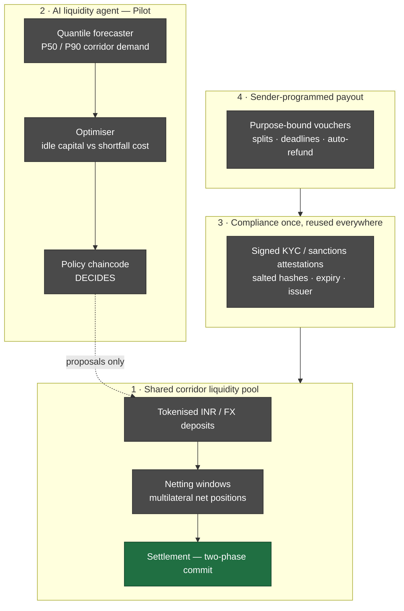
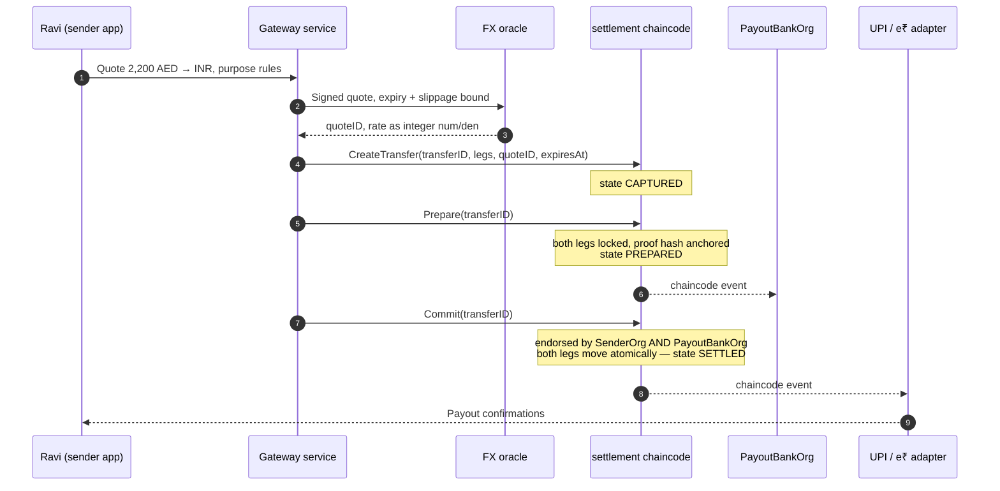

# Architecture — Tributary Pilot

> Status: Phase 0. Sections marked **Planned** are not implemented. Anything not
> marked is implemented and covered by a test or script you can run yourself.

## 1. The problem, stated precisely

A remittance into India passes through a sending institution abroad, one or more
correspondent banks, and an Indian payout bank. None of them share a ledger, so
each one must hold its own buffer of pre-funded capital against flows it cannot
see. The buffers are sized independently against the same uncertain demand, which
is why the capital cost is high and why settlement is slow: no party can release
its leg until it trusts that the other leg happened.

Tributary Pilot attacks three parts of that at once: the duplicated buffers
(shared pool + netting), the sizing guesswork (forecasting agent), and the trust
gap at settlement (two-phase commit on a shared ledger).

## 2. Layers

Green is running in this repo today; grey is Phase 1. The dotted arrow is the
core governance rule: **the agent proposes, the policy chaincode decides.** The
agent holds no key that can move money.

## 3. Organisations

| Org | Real-world role | Fabric/DRUNIX identity | Phase 0 status |
|---|---|---|---|
| `SenderOrg` | UAE money transfer operator originating the transfer | `Org1MSP` | Mapped to the stock `Org1` of the DRUNIX test network |
| `PayoutBankOrg` | Indian bank paying out via UPI / e₹ | `Org2MSP` | Mapped to the stock `Org2` of the DRUNIX test network |
| `PlatformOrg` | NPCI platform node, regulator observer | `Org3MSP` | **Planned** — see note below |

**Note on the third org.** The DRUNIX sample network at
`drunix-network/test-network` ships with exactly two peer organisations and, unlike
stock Hyperledger Fabric, carries no `addOrg3` sample. Standing up `PlatformOrg`
means hand-writing `configtx`, `crypto-config` and compose material. Phase 0
deliberately does not spend its remaining hours there; the settlement chaincode's
access control is nevertheless written against named MSP IDs, so adding the org is
configuration plus an endorsement-policy change, not a code change.

## 4. Why DRUNIX, and how it differs from stock Fabric

DRUNIX is an enhanced fork of Hyperledger Fabric v2.5.x maintained by NPCI. Four
differences matter to us and are reflected in our scripts and docs:

| DRUNIX | Stock Fabric | Why it matters here |
|---|---|---|
| Peer split into **Lite Peer** (endorsement, stateless, no local ledger) and **Committing Peer** (validation, MVCC, commit) | One peer does both | Endorsement capacity scales horizontally — relevant to remittance burst traffic at salary windows |
| **Stateless Validation Service** performs endorsement-policy and signature checks, round-robin from the Committing Peer | VSCC runs inside the peer | Validation scales independently of ledger storage |
| **YugabyteDB** (SQL) supported as on-chain state store, default in the sample network | LevelDB / CouchDB only | Net-position and corridor queries are naturally relational |
| **KeyDB** shared transient store across Lite and Committing Peers in an org | Private data pushed peer-to-peer at endorsement, fetched again at commit | Removes two network round-trips for private data — our PII-adjacent collections in Phase 1 |

Upstream DRUNIX is **not vendored and not modified** in this repository. Our
`network/` folder only wraps its `network.sh` with our own org naming, channel and
chaincode arguments.

## 5. Channels and contracts

Phase 0 runs a single channel, `mychannel` (the sample network's default), with one
chaincode.

| Contract | Channel | Responsibility | Phase |
|---|---|---|---|
| `settlement` | `mychannel` | Two-phase commit over both legs of a transfer; per-org balances in integer minor units | **0 — implemented** |
| `token` | `mychannel` | MIST-aligned Issue / Manage / Settle / Transact; role-restricted mint and burn | 1 |
| `pool` | `mychannel` | Member deposits and withdrawals; netting windows computing multilateral net positions | 1 |
| `policy` | `mychannel` | Limits, approved members, maker-checker; every agent action passes through it | 1 |
| `attestation` | `mychannel` | KYC / sanctions attestations as salted hashes with issuer and expiry | 1 |
| `payout` | `mychannel` | Purpose-bound vouchers, splits, deadline with automatic refund | 1 |

In Phase 1 the foreign side is represented as a **second channel** and a coordinator
service runs NPCI's cross-chain two-phase commit between them. That is labelled
"NPCI Interop/Coordinator pattern — simulated" wherever it appears.

## 6. Data flow — the running example

Ravi in Dubai sends 2,200 AED. ₹30,000 is bound to his sister's college fees; the
remainder goes to his mother in Madurai over UPI. All data is synthetic.

Steps 1–3 and the adapter in step 11 are Phase 1 and simulated. Steps 4–10 — the
chaincode state machine, the locks, the atomic move and the endorsement
requirement — are what Phase 0 implements and tests.

## 7. Money representation

All amounts are **integer minor units**: paise for INR, fils for AED, cents for
USD. There are no floating-point amounts anywhere in the chaincode. Exchange rates
are stored as an integer numerator and denominator, never as a decimal, so that
every endorsing peer computes a bit-identical result.

## 8. Determinism

Chaincode must produce identical output on every endorsing peer. The settlement
contract therefore uses `stub.GetTxTimestamp()` rather than wall-clock time, no
randomness, no map iteration in any output, and makes no external calls. These are
checked in review and exercised by the unit tests.

## 9. Related documents

- [SETTLEMENT_FLOW.md](SETTLEMENT_FLOW.md) — the 2PC sequence and state machine
- [THREAT_MODEL.md](THREAT_MODEL.md) — threats mapped to controls and tests
- [ASSUMPTIONS.md](ASSUMPTIONS.md) — synthetic data, cost and capital-savings models
- [ROADMAP.md](ROADMAP.md) — Phase 1 order of work
