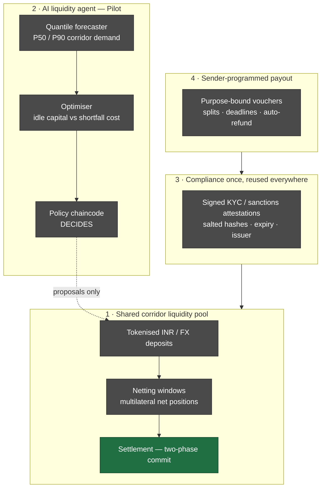
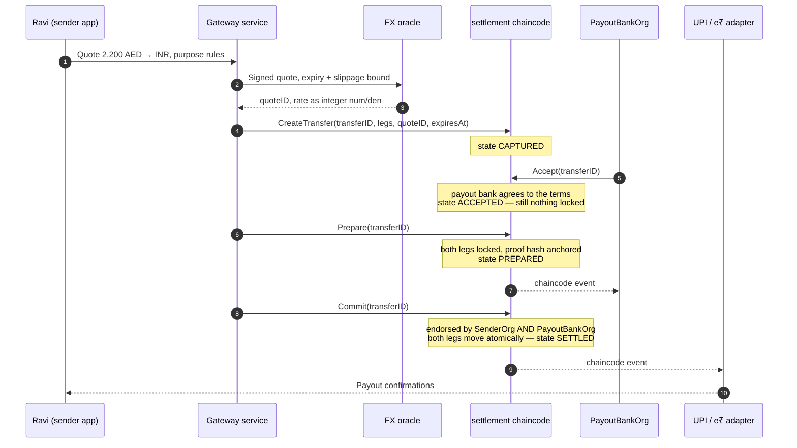

# Architecture — Tributary Pilot

> Status: Phase 0. Sections marked **Planned** are not implemented. Anything not
> marked is implemented and covered by a test or script you can run yourself.

## 1. The problem, stated precisely

A remittance into India passes through a sending institution abroad, one or more
correspondent banks, and an Indian payout bank. None of them share a ledger, so
each one must hold its own buffer of pre-funded capital against flows it cannot
see. The buffers are sized independently against the same uncertain demand, which
is why the capital cost is high and why settlement is slow: no party can release
its leg until it trusts that the other leg happened.

Tributary Pilot attacks three parts of that at once: the duplicated buffers
(shared pool + netting), the sizing guesswork (forecasting agent), and the trust
gap at settlement (two-phase commit on a shared ledger).

## 2. Layers

Green is running in this repo today; grey is Phase 1. The dotted arrow is the
core governance rule: **the agent proposes, the policy chaincode decides.** The
agent holds no key that can move money.

## 3. Organisations

| Org | Real-world role | Fabric/DRUNIX identity | Phase 0 status |
|---|---|---|---|
| `SenderOrg` | UAE money transfer operator originating the transfer | `Org1MSP` | Mapped to the stock `Org1` of the DRUNIX test network |
| `PayoutBankOrg` | Indian bank paying out via UPI / e₹ | `Org2MSP` | Mapped to the stock `Org2` of the DRUNIX test network |
| `PlatformOrg` | NPCI platform node, regulator observer | `Org3MSP` | Channel member. Holds an admin identity and read access; **runs no peer** |

**Note on the third org.** The DRUNIX sample network at
`drunix-network/test-network` ships with exactly two peer organisations and, unlike
stock Hyperledger Fabric, carries no `addOrg3` sample. `network/add-platform-org.sh`
therefore drives the standard Fabric add-organisation flow from this repository:
generate crypto with `cryptogen`, print the organisation definition with
`configtxgen -printOrg` against our own minimal `configtx.yaml`, splice it into the
fetched channel config, compute the delta, collect signatures from the
organisations already on the channel, and submit. Upstream's own `configtx.yaml`
is never modified.

`PlatformOrg` joins as a **member with an identity, not as an endorser**. A
regulator observer needs to read the ledger and to be a recognised party on the
channel; it does not need to endorse. That is also what makes it the right
instrument for threat T2.1: because its proposals are accepted by the channel and
reach the chaincode, the chaincode's own access control is what has to turn them
away — and it does. Standing up its Lite, Committing and Validation peers is
Phase 1 work, tracked in [ROADMAP.md](ROADMAP.md).

Adding `PlatformOrg` to the settlement endorsement policy would be a
configuration change, not a code change: the contract reads MSP IDs from the
signing identity and hard-codes none.

## 4. Why DRUNIX, and how it differs from stock Fabric

DRUNIX is an enhanced fork of Hyperledger Fabric v2.5.x maintained by NPCI. Four
differences matter to us and are reflected in our scripts and docs:

| DRUNIX | Stock Fabric | Why it matters here |
|---|---|---|
| Peer split into **Lite Peer** (endorsement, stateless, no local ledger) and **Committing Peer** (validation, MVCC, commit) | One peer does both | Endorsement capacity scales horizontally — relevant to remittance burst traffic at salary windows |
| **Stateless Validation Service** performs endorsement-policy and signature checks, round-robin from the Committing Peer | VSCC runs inside the peer | Validation scales independently of ledger storage |
| **YugabyteDB** (SQL) supported as on-chain state store, default in the sample network | LevelDB / CouchDB only | Net-position and corridor queries are naturally relational |
| **KeyDB** shared transient store across Lite and Committing Peers in an org | Private data pushed peer-to-peer at endorsement, fetched again at commit | Removes two network round-trips for private data — our PII-adjacent collections in Phase 1 |

Upstream DRUNIX is **not vendored and not modified** in this repository. Our
`network/` folder only wraps its `network.sh` with our own org naming, channel and
chaincode arguments.

## 5. Channels and contracts

Phase 0 runs a single channel, `mychannel` (the sample network's default), with one
chaincode.

| Contract | Channel | Responsibility | Phase |
|---|---|---|---|
| `settlement` | `mychannel` | Capture → accept → prepare → commit over both legs; a double-entry journal underneath; **and the netting path** | **0 — implemented** |
| `token` | `mychannel` | MIST-aligned Issue / Manage / Settle / Transact; role-restricted mint and burn | 1 |
| `pool` | `mychannel` | Member deposits and withdrawals. The netting half is **built, inside `settlement`**; deposits and withdrawals are not | 1 (part built) |
| `policy` | `mychannel` | Limits, approved members, maker-checker; every agent action passes through it | 1 |
| `attestation` | `mychannel` | KYC / sanctions attestations as salted hashes with issuer and expiry | 1 |
| `payout` | `mychannel` | Purpose-bound vouchers, splits, deadline with automatic refund | 1 |

In Phase 1 the foreign side is represented as a **second channel** and a coordinator
service runs NPCI's cross-chain two-phase commit between them. That is labelled
"NPCI Interop/Coordinator pattern — simulated" wherever it appears.

### Two settlement paths, deliberately

`settlement` carries two ways to move value, and the choice between them is an
economic one rather than a matter of taste.

| | Two-phase commit | Netting |
|---|---|---|
| Finality | per transfer, immediate | at the window close |
| Writes to shared balance keys | 2 per transfer | at most 1 per account per window |
| Concurrency | serialises on the payer's key | institutions submit in parallel |
| Suits | high-value payment-versus-payment | the retail corridor, where flow cancels |

Both write through the same journal, so the books balance across the two
together. §11 of [SETTLEMENT_FLOW.md](SETTLEMENT_FLOW.md) sets out why the
hot-key problem makes the second one necessary and what it costs.

## 6. Data flow — the running example

Ravi in Dubai sends 2,200 AED. ₹30,000 is bound to his sister's college fees; the
remainder goes to his mother in Madurai over UPI. All data is synthetic.

Steps 1–3 and the payout adapter at the end are Phase 1 and simulated. The
chaincode state machine, the locks, the atomic move and the endorsement
requirement are what Phase 0 implements and tests.

`Accept` is the half of NPCI's capture/accept phase that the first
implementation collapsed away. Without it, `Prepare` — which locks *both*
parties' funds — was reachable by the sending organisation alone. See
[SETTLEMENT_FLOW.md](SETTLEMENT_FLOW.md) and threat T2.5.

## 7. Money representation

All amounts are **integer minor units**: paise for INR, fils for AED, cents for
USD. There are no floating-point amounts anywhere in the chaincode. Exchange rates
are stored as an integer numerator and denominator, never as a decimal, so that
every endorsing peer computes a bit-identical result.

## 8. Determinism

Chaincode must produce identical output on every endorsing peer. The settlement
contract therefore uses `stub.GetTxTimestamp()` rather than wall-clock time, no
randomness, no map iteration in any output, and makes no external calls. These are
checked in review and exercised by the unit tests.

Netting raises the stakes on the map-iteration rule. Folding obligations into
net positions is naturally a map operation, and Go randomises map iteration
order, so emitting positions in that order would give each endorsing peer a
different write set and every netted transaction would fail validation. The
fold sorts by account name before emitting anything, and pairing breaks ties by
name for the same reason. `TestNetPositions_AreOrderedByAccount` exists because
removing that sort was not caught by the obvious determinism test — the pairing
step re-sorts, so the defect hid behind it.

## 10. The service layer, and the read side

The chaincode is the write side and the authority. Around it:

| Process | What it does | Reads from | Writes to |
|---|---|---|---|
| `services/gateway` | HTTP API and the corridor view | peers, and the projection | peers |
| `services/projector` — projector | replays chaincode events from a checkpoint | the Committing Peer | the read model and the outbox |
| `services/projector` — worker | pays beneficiaries on the far rail | the outbox | payouts, dead letters |

The projector connects to the **Committing Peer**, not the Lite Peer. DRUNIX
splits the peer in two and only the Committing Peer holds a ledger, so only it
can replay blocks from a checkpoint — a Lite Peer delivers no events at all.
That was found by probing both.

Reads split by whether they must be authoritative. Anything that has to be true
at the instant it is read — a balance before a transfer, a state before an
action — goes to a peer. Anything that is a view goes to the projection, which
is cheaper, answers questions no chaincode query can (totals over time), and is
a little behind. **The lag is reported, not hidden.**

The read model, the checkpoint and the work queue are one SQLite file on
purpose: an event's three consequences have to commit together or a crash
between them loses work or does it twice. [PIPELINE.md](PIPELINE.md) sets out
each failure mode and the test that holds it down.

## 9. Related documents

- [SETTLEMENT_FLOW.md](SETTLEMENT_FLOW.md) — the 2PC sequence, the state machine, and netting
- [PIPELINE.md](PIPELINE.md) — the projector, the queue and the payout worker
- [THREAT_MODEL.md](THREAT_MODEL.md) — threats mapped to controls and tests
- [ASSUMPTIONS.md](ASSUMPTIONS.md) — synthetic data, cost and capital-savings models
- [ROADMAP.md](ROADMAP.md) — Phase 1 order of work
- [SUBMISSION_SUMMARY.md](SUBMISSION_SUMMARY.md) — the five lines for the form, and what we deliberately do not claim
