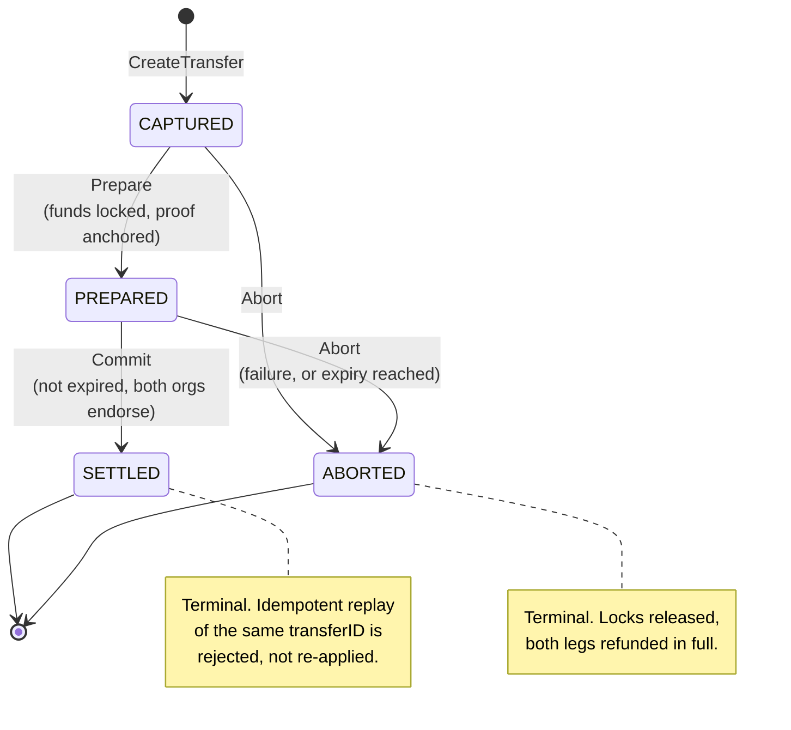
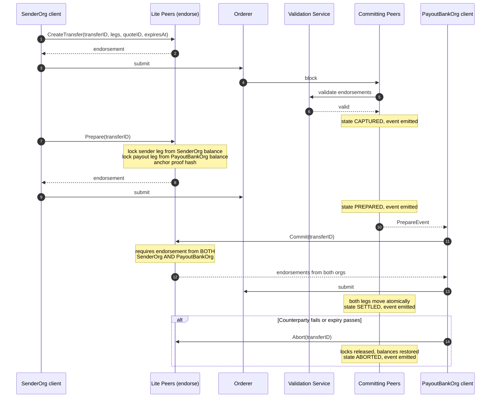

# Settlement flow — two-phase commit

> Status: Phase 0. The state machine, the guards and the endorsement requirement
> described here are implemented in `chaincode/settlement` and covered by unit
> tests. The second ledger and the coordinator service are Phase 1.

## 1. What problem 2PC solves

If the sending institution releases its leg before the payout bank releases its
own, it is exposed for the gap between them — the foreign-exchange settlement risk
that killed Bankhaus Herstatt in 1974 and is still the reason correspondent
banking pre-funds so heavily. Two-phase commit removes the gap: **both legs
complete or neither does.** This is payment-versus-payment (PvP) for currency pairs
and delivery-versus-delivery (DvD) for tokenised claims.

## 2. The four phases

| Phase | Call | What happens | Resulting state |
|---|---|---|---|
| Capture / accept | `CreateTransfer` | Transfer recorded with both legs, the FX quote ID and an expiry. Nothing is locked, nothing has moved. | `CAPTURED` |
| Prepare | `Prepare` | Both legs are locked against the payer balances. A proof hash over the transfer's canonical fields is anchored. | `PREPARED` |
| Commit | `Commit` | Guards re-checked, locks consumed, both legs move in one transaction. | `SETTLED` |
| Abort | `Abort` | Locks released, balances restored. Callable by either party on failure, or by anyone once expired. | `ABORTED` |

The verify-proofs step of NPCI's cross-chain pattern sits between prepare and
commit. In Phase 0 both legs live on one ledger, so the proof hash is anchored and
re-checked locally rather than exchanged with a second network. The call sites are
in place for Phase 1 to carry a real counterparty proof.

## 3. State machine

Every other edge is rejected. In particular `CAPTURED → SETTLED` is **not** an
edge: committing without preparing fails, and there is a unit test that proves it.

## 4. Sequence

The Lite Peer / Validation Service / Committing Peer split in this diagram is
DRUNIX-specific, not stock Fabric. See
[ARCHITECTURE.md §4](ARCHITECTURE.md#4-why-drunix-and-how-it-differs-from-stock-fabric).

## 5. Guards enforced in chaincode

Each of these is a rejection path with a named unit test behind it.

| Guard | Rejected because |
|---|---|
| `Commit` on a transfer that is not `PREPARED` | Skipping prepare would let a leg move unlocked |
| `Commit` after `expiresAt` | The FX quote and the counterparty's intent have both lapsed |
| `CreateTransfer` with an existing `transferID` | Replay protection; the ID is the idempotency key |
| `Prepare` with insufficient available balance | A lock must be fully funded or not taken at all |
| `Commit` submitted by an org that is not a party | Only `SenderOrg` and `PayoutBankOrg` may settle their own transfer |
| `Commit` endorsed by only one org | Endorsement policy requires `SenderOrg AND PayoutBankOrg` |
| Non-positive or non-integer leg amounts | Money is integer minor units; zero and negative legs are meaningless |

## 6. Expiry and the clock

Expiry is compared against `stub.GetTxTimestamp()`, which is the timestamp in the
transaction proposal and is therefore identical on every endorsing peer. Using
`time.Now()` would make endorsements disagree near the boundary and the
transaction would fail validation non-deterministically. `expiresAt` is supplied by
the client as a Unix second and is itself bounded by the FX quote's own expiry.

## 7. Locks and balances

Phase 0 keeps a minimal balance map inside the settlement contract: per org, per
currency, a `total` and a `locked` amount, both in minor units. Available balance
is `total - locked`.

- `Prepare` increases `locked` on both payers.
- `Commit` decreases `locked` and `total` on each payer and increases `total` on
  each payee, in the same transaction.
- `Abort` decreases `locked` only, leaving `total` untouched — a full refund.

The invariant `0 <= locked <= total` holds after every operation. Phase 1 replaces
this map with the `token` and `pool` contracts; the state machine above does not
change when it does.

## 8. Events

`CreateTransfer`, `Prepare`, `Commit` and `Abort` each emit a chaincode event
carrying the transfer ID, the new state and the leg amounts. Phase 1's event
listener drives the payout adapter and the treasury dashboard from these.
