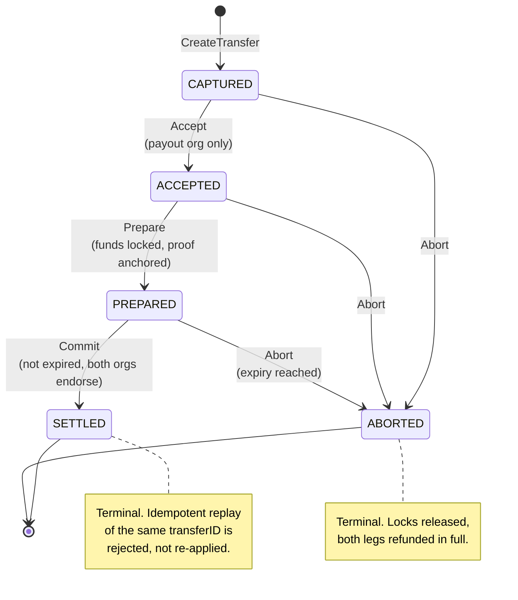
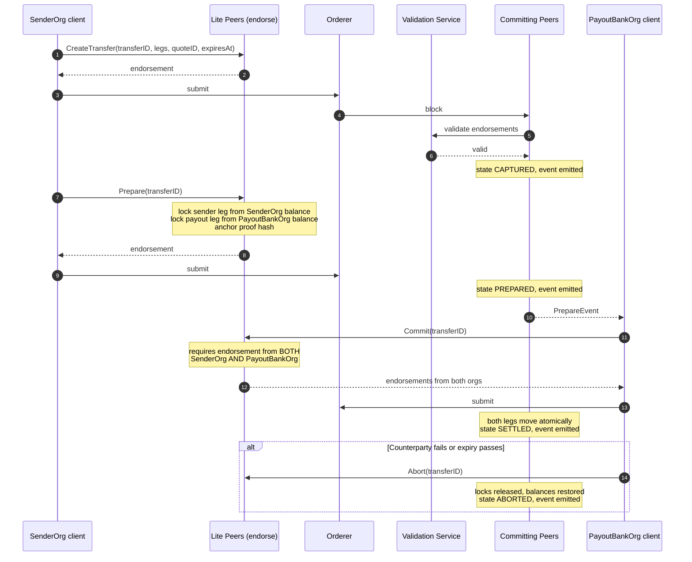

# Settlement flow — two-phase commit, and netting

> Status: Phase 0. The state machine, the guards and the endorsement requirement
> described here are implemented in `chaincode/settlement` and covered by unit
> tests. The second ledger and the coordinator service are Phase 1.

## 1. What problem 2PC solves

If the sending institution releases its leg before the payout bank releases its
own, it is exposed for the gap between them — the foreign-exchange settlement risk
that killed Bankhaus Herstatt in 1974 and is still the reason correspondent
banking pre-funds so heavily. Two-phase commit removes the gap: **both legs
complete or neither does.** This is payment-versus-payment (PvP) for currency pairs
and delivery-versus-delivery (DvD) for tokenised claims.

## 2. The four phases

| Phase | Call | What happens | Resulting state |
|---|---|---|---|
| Capture | `CreateTransfer` | Transfer recorded with both legs, the FX quote ID and an expiry. Nothing is locked, nothing has moved. | `CAPTURED` |
| Accept | `Accept` | The payout organisation agrees to the terms. Callable **only** by the payout org. Still nothing locked. | `ACCEPTED` |
| Prepare | `Prepare` | Both legs are locked against the payer balances. A proof hash over the transfer's canonical fields is anchored. | `PREPARED` |
| Commit | `Commit` | Guards re-checked, locks consumed, both legs move in one transaction. | `SETTLED` |
| Abort | `Abort` | Locks released, balances restored. Callable by either party on failure, or by anyone once expired. | `ABORTED` |

The verify-proofs step of NPCI's cross-chain pattern sits between prepare and
commit. In Phase 0 both legs live on one ledger, so the proof hash is anchored and
re-checked locally rather than exchanged with a second network. The call sites are
in place for Phase 1 to carry a real counterparty proof.

## 3. State machine



Every other edge is rejected, and two absences are deliberate:

- **`CAPTURED → SETTLED`** is not an edge. Committing without preparing would move
  a leg that was never locked, and a unit test proves it fails.
- **`CAPTURED → PREPARED`** is not an edge either. `Prepare` locks *both* parties'
  funds, so without an explicit `Accept` the sending organisation could tie up the
  payout bank's liquidity on its own. This was a real defect found in review: the
  sender could create a transfer with a far-future expiry, prepare it alone, and
  the payout bank could not abort until that expiry passed. `Accept` plus the
  bounded window in §6 closes it.

## 4. Sequence



The Lite Peer / Validation Service / Committing Peer split in this diagram is
DRUNIX-specific, not stock Fabric. See
[ARCHITECTURE.md §4](ARCHITECTURE.md#4-why-drunix-and-how-it-differs-from-stock-fabric).

## 5. Guards enforced in chaincode

Each of these is a rejection path with a named unit test behind it.

| Guard | Rejected because |
|---|---|
| `Commit` on a transfer that is not `PREPARED` | Skipping prepare would let a leg move unlocked |
| `Commit` after `expiresAt` | The FX quote and the counterparty's intent have both lapsed |
| `CreateTransfer` with an existing `transferID` | Replay protection; the ID is the idempotency key |
| `Prepare` with insufficient available balance | A lock must be fully funded or not taken at all |
| `Commit` submitted by an org that is not a party | Only `SenderOrg` and `PayoutBankOrg` may settle their own transfer |
| `Commit` endorsed by only one org | Endorsement policy requires `SenderOrg AND PayoutBankOrg` |
| `Prepare` before `Accept` | The payout org's funds cannot be locked without its agreement |
| `Accept` by anyone but the payout org | Only the counterparty can consent on its own behalf |
| `expiresAt` further ahead than the settlement window | An unbounded lock is a denial-of-service on the counterparty's liquidity |
| A beneficiary reference equal to either party's MSP ID | A leg that pays its own account is meaningless, and exposed a read-your-writes defect |
| Non-positive or non-integer leg amounts | Money is integer minor units; zero and negative legs are meaningless |

## 6. Expiry, the clock, and the settlement window

Expiry is compared against `stub.GetTxTimestamp()`, which is the timestamp in the
transaction proposal and is therefore identical on every endorsing peer. Using
`time.Now()` would make endorsements disagree near the boundary and the
transaction would fail validation non-deterministically. `expiresAt` is supplied by
the client as a Unix second and is itself bounded by the FX quote's own expiry.

It is also bounded by the contract: `expiresAt` may be no more than
`MaxSettlementWindowSeconds` (900, fifteen minutes) past the transaction
timestamp. A prepared transfer can only be aborted once it has expired, so an
unbounded expiry would let a sender hold the counterparty's funds for as long as
it liked. Fifteen minutes is the lifetime of a signed FX quote, which is the real
limit on how long a transfer's terms stay meaningful.

## 7. Reading your own writes

Fabric does not give chaincode read-your-writes semantics. `SetState` appends to
the transaction's write set (`txSimulator.SetState` →
`rwsetBuilder.AddToWriteSet`), while `GetState` reads the state database directly
(`queryExecutor.getState` → `txmgr.db.GetState`) and never consults it. A second
read of a key this transaction has already written returns the **pre-transaction**
value.

That matters here because `Commit` moves two legs, and the two legs can touch the
same account and currency — when both legs are in the same currency, or when the
beneficiary reference names a party. An earlier version read each balance
straight from state, so the second write silently discarded the first: value was
created when an account paid itself, and destroyed when a credit was followed by a
debit.

Every balance operation in one invocation therefore goes through a single
`balanceBook`, which caches what the transaction has already written so later
reads within that transaction see it. The mock stub used in tests reproduces
Fabric's semantics exactly — buffered writes, invisible to `GetState`, discarded
when the call returns an error — so this class of bug fails the tests rather than
hiding behind a too-permissive mock.

## 8. Double entry, and why locks are an account

Balances are never written. Every movement appends one immutable `Entry` naming
the account value leaves, the account it arrives at, and a single amount that
applies to both. Per-account totals are a materialised fold of those entries.

The property that buys: **an unbalanced entry cannot be expressed.** Conservation
is not something a test remembers to assert, it is a consequence of the shape of
the data. Summed across every account, each currency is always exactly zero.

Two counter-accounts make that true in the awkward cases:

| Account | Holds | Why |
|---|---|---|
| `issuance:<CCY>` | The negative of everything outstanding | Money entering the system is a movement too, not an exception. "How much have we issued" is a balance you read, not a number you track |
| `escrow:<transferID>` | A prepared transfer's locked legs | A lock is a real movement, not a flag. Funds under lock have left the payer, so "available" is just the balance — nothing to subtract and nothing to reconcile |

So `Prepare` posts payer → escrow, `Commit` posts escrow → payee, and `Abort`
posts escrow → payer. Each is a complete, balanced entry.

One bound worth stating: a balance is the signed difference of two unsigned
totals, so each side is capped at `MaxInt64`. That is about 92 quadrillion minor
units. The cap exists so the type cannot silently wrap, not because anyone will
reach it.

## 9. Locks and balances, as they were

Phase 0 keeps a minimal balance map inside the settlement contract: per org, per
currency, a `total` and a `locked` amount, both in minor units. Available balance
is `total - locked`.

- `Prepare` increases `locked` on both payers.
- `Commit` decreases `locked` and `total` on each payer and increases `total` on
  each payee, in the same transaction.
- `Abort` decreases `locked` only, leaving `total` untouched — a full refund.

The invariant `0 <= locked <= total` holds after every operation. Phase 1 replaces
this map with the `token` and `pool` contracts; the state machine above does not
change when it does.

## 10. Events

`CreateTransfer`, `Accept`, `Prepare`, `Commit` and `Abort` each emit a chaincode event
carrying the transfer ID, the new state and the leg amounts. Phase 1's event
listener drives the payout adapter and the treasury dashboard from these.

## 11. The netting path, and why 2PC alone does not scale

The two-phase commit above is atomic, and it serialises.

Every transfer on that path reads and writes the payer's balance key. Two
transfers from one institution in the same block both read the same version of
that key, and the second is thrown out at validation with
`MVCC_READ_CONFLICT`. A shared liquidity pool makes it worse: every transfer in
the corridor touches the pool's key, so the corridor settles at roughly one
transfer per block.

**Adding peers does not help.** The conflict is on the key, not on the CPU. This
is the single most common reason a blockchain settlement demo quotes a
throughput figure it cannot reproduce under concurrent load.

### What a transfer touches instead

Submitting an obligation writes exactly two keys:

| Key | Who writes it | Contends with |
|---|---|---|
| `oblig:<ccy>:<seq>:<obligationID>` | whoever submits | nothing — the ID is unique |
| `expo:<ccy>:<account>` | that account only | that account's own submissions |

Neither is shared between institutions, so two banks submit in parallel at full
speed. Writes to the shared balance keys drop from two per transfer to at most
one per participating account per window — a bound that does not grow with
volume.

`TestNetting_TwoInstitutionsSubmitWithoutContending` checks this by taking both
transactions' actual read and write sets and showing neither writes anything
the other touched, which is precisely the condition Fabric's MVCC check
arbitrates. It is not asserted in prose; it is measured.

### The window number is arithmetic, not state

The obvious design keeps a "current window" pointer in state. That pointer
would be read by every submission and written whenever the window rolled —
recreating exactly the hot key it was meant to remove.

Instead:

```
seq = txTime / NettingWindowSeconds
```

Every endorsing peer sees the same proposal timestamp and computes the same
window, with no read, no write and no coordination. The window number is a
function of time, not a piece of state.

### Why closing a window is safe

`CloseWindow` ranges over a window's obligations, and §7 explains why a range
query inside a writing transaction is normally dangerous: Fabric records the
range in the read set, and another transaction inserting a key into it
invalidates the close. That is a phantom read.

Here it cannot happen. A window may only be closed once `seq` is strictly in
the past, and a submission always lands in the window its own timestamp names.
**No transaction can ever write into a past window's key range**, so the range
is immutable before the close reads it. Time does the locking, so there is
nothing to lock.

### Netting, and what gets posted

Obligations fold into one signed position per account. Because every obligation
contributes `+amount` to one account and `-amount` to another, the positions
always sum to zero. Debtors are then matched against creditors largest-first;
each step closes out at least one side, so the number of postings is at most
`debtors + creditors - 1` against two per obligation unnetted.

An institution whose position nets to zero drops out entirely — its balance is
never written. In a three-party chain where A owes B and B owes C the same
amount, the whole window settles as one movement from A to C, and B is not
touched.

The fold sorts by account name before emitting anything. Go randomises map
iteration order, so a fold that leaked map order would give each endorsing peer
a different write set and every netted transaction would fail validation.

### Exposure, and why the two paths cannot double-spend

An obligation moves nothing, so something has to stop an institution promising
the same money twice. `expo:<ccy>:<account>` records what it has committed to
windows that have not settled, and the journal subtracts that from a balance
before allowing **any** debit — netting or two-phase commit. Without it, an
institution could commit its whole balance to a window and then lock the same
funds through `Prepare`, with both paths believing they had cover.

Exposure deliberately spans windows. An institution that could ignore a past
but unclosed window would be able to commit the same funds again simply by
waiting for the window to roll.

**Order matters at close.** The reservation is released *before* the net is
posted, not after. The journal refuses a debit that eats into a reservation,
and a window's own gross is part of that reservation until released — so
posting first would have the close blocked by the very obligations it was
settling. An institution that had committed its whole balance would deadlock on
a net of almost nothing. Releasing first is safe in the other direction too:
submission already established `balance >= exposure`, and `net <= gross`, so
after the release the available balance is at least `gross`, which is at least
the net about to be debited.

### What this does and does not save

It compresses **the value that moves at settlement**. It does not reduce the
collateral an institution must hold while a window is open, because cover is
checked against gross outgoing rather than the net. The net is not known until
the window closes, and its incoming side lives on other institutions' keys —
which a submission must not read if it is to stay conflict-free.

Freeing that collateral needs bilateral credit limits, so cover becomes
`gross_out - agreed_line`. That is a counterparty-risk decision, not a
refactor, and it is on the roadmap rather than quietly assumed here.

### Honest limits

- **Parallelism is across institutions, not within one.** Two obligations from
  the same bank contend on its exposure record.
  `TestNetting_OneInstitutionSerialisesOnItsOwnExposure` pins that down rather
  than letting it pass unnoticed. The fix is to shard the exposure record,
  which changes one key's shape and nothing else.
- **Issuance is still a shared key.** Minting is not on the hot path here, but
  it would need sharding before it was.
- **Netting defers finality to the window.** A party that needs settlement
  finality on an individual transfer uses the two-phase commit path, which is
  why both exist. High-value payment-versus-payment belongs on 2PC; the retail
  corridor belongs on netting.

### Multilateral, not bilateral

Two institutions netting against each other can only cancel what happens to
flow both ways. The cases worth having three parties for are the ones
bilateral netting cannot see at all, and both run live in
`network/demo-netting-multilateral.sh`:

**A cycle.** Org1 owes Org2, Org2 owes Org3, Org3 owes Org1, all the same
amount. Every position nets to zero, so the window settles by moving nothing
whatsoever — zero postings, not one. No two of those three obligations offset
each other, so no amount of bilateral netting finds this.

**A chain.** Org1 owes Org2 and Org2 owes Org3 the same amount. Org2's position
is zero, so it drops out of the pairing entirely and its balance is never
written. The window settles as a single movement from Org1 straight to Org3 —
two institutions that have no obligation between them.

PlatformOrg takes part in both while running no peer of its own. It signs with
its own admin identity and addresses another organisation's Lite Peer, so the
chaincode reads `Org3MSP` from the signature while the endorsement policy is
satisfied by the two organisations that do run peers. Being a party to a
settlement and running infrastructure for it are separate things.

### The compression figure is floored, and it is not computed the obvious way

`compressionBps` reports the share of the gross that never had to move, in
integer basis points. Two decisions in four lines of arithmetic:

It is **floored, never rounded**. The alternative overstates the saving, which
is the one direction a savings metric must not err in.

It is computed with `bits.Mul64` and `bits.Div64` rather than as
`10000 - net*10000/gross`. Both figures are `uint64` and the journal permits
them up to `MaxInt64`, so the naive multiplication overflows once the gross
passes roughly 1.8e15 minor units and the reported compression becomes
nonsense — silently, on the one number this whole path exists to produce. The
128-bit intermediate is exact for every input the ledger can hold.
`TestCompressionBps` fails on the naive formula at two of its cases.

### Double entry does not catch a wrong net

Worth stating because it is easy to assume otherwise. Doubling both sides of a
posting leaves the books perfectly balanced while settling the wrong figure —
the conservation check from §8 sails straight past it. This was confirmed by
injecting exactly that fault.

The invariant that does catch it is that **every account must move by exactly
its net position in the window**, and that is
`TestNetting_EveryAccountMovesByExactlyItsNetPosition`. The live run checks the
same thing against committed state, deriving the expected net from the
obligations the chain actually recorded rather than from what the script
intended to submit.
